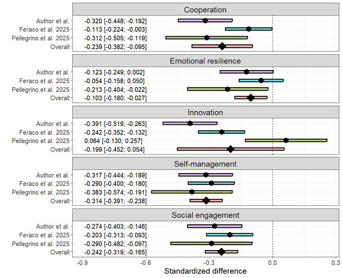

[← All projects](../projects.qmd){.project-back-link}

::: {.project-summary}
[Research question]{.project-summary-label}

::: {.project-summary-question}

:::

**Focus:** SEB skills, academic outcomes, and well-being in students with and without specific learning disabilities (SLDs).

**Outputs:** Studies from middle school to university, a replication and synthesis, and a summary of the main findings.

::: {.project-detail-actions}
[Key findings](#key-findings){.resource-button}
[Related publications](#publications){.resource-details}
:::
:::

## The project

Students with SLDs face challenges that may extend beyond reading, writing, and mathematics. This programme examines their social, emotional, and behavioral (SEB) skills and how these skills relate to academic and non-academic outcomes.

The aim is to identify both resources and vulnerabilities, while examining whether the same skills relate to outcomes differently in students with and without SLDs.

## Research approach

The programme combines group comparisons, studies of academic and well-being outcomes, preregistered replication, and synthesis. It covers students from middle school to university, with particular attention to self-regulated learning and study-related factors.

## Key findings

Across the studies and their synthesis [@feracoSocialEmotionalBehavioral2025; @feracoSocialEmotionalBehavioral2026; @pellegrinoUniversityStudentsSpecific2026]:

1. **Some skill differences are small but consistent.** Students with SLDs tend to report lower self-management, cooperation, and social engagement skills across samples and educational levels.
2. **Associations with achievement differ between groups.** Self-management is associated with higher achievement among students without SLDs, while this association is weaker or absent in the SLD group in the studies reported here.
3. **Well-being remains relevant in both groups.** SEB skills are associated with life satisfaction and other non-academic outcomes, including peer acceptance, in students with and without SLDs.
4. **Study-related factors also deserve attention.** University students with SLDs report vulnerabilities in academic self-efficacy, self-regulated learning, and burnout-related outcomes.

## Implications and next questions

The findings suggest that skill development and the conditions in which skills are used both deserve attention. Support for students with SLDs should consider study-related and structural barriers, as well as individual resources.

The studies describe group differences and associations. They do not, by themselves, establish that improving a particular skill will cause better grades or well-being. Testing support strategies is a further research question.

## Collaborators

Gerardo Pellegrino, Nicole Casali, Chiara Meneghetti, and Barbara Carretti.

## Funding

The programme initially received a research grant from the Department of General Psychology in 2023.

## Publications

::: {#refs}
:::
